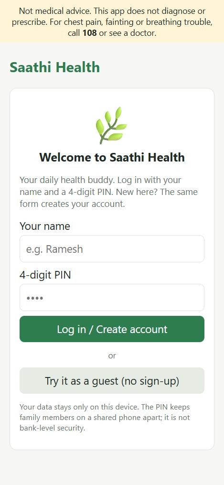
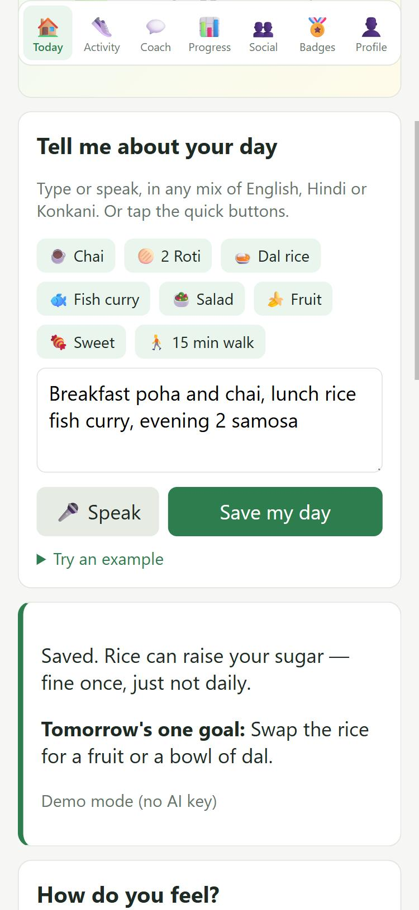
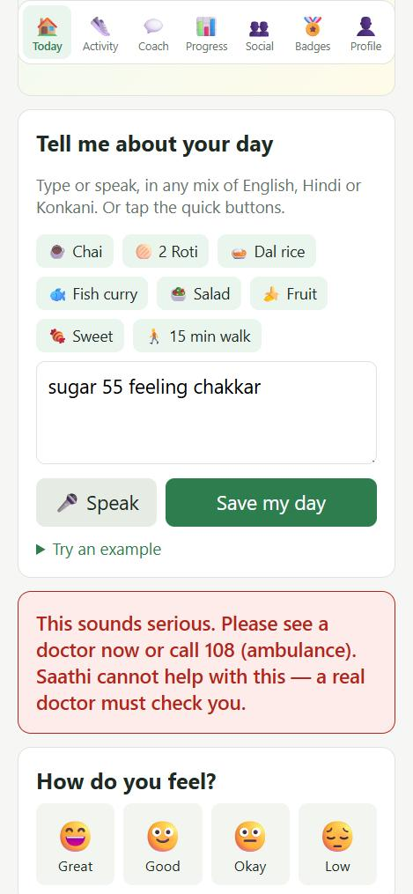
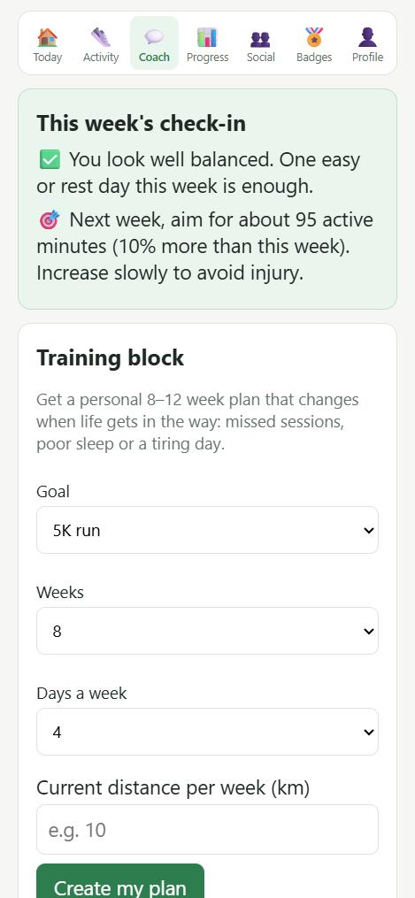

# Report: Saathi Health

**Vishal Vasudev Toraskar · Roll No. PGDMAI-25-15**

> Up to 2,500 words, not counting tables, screenshots and references. Bullet points are fine. Submit this file as it is, or export it to `REPORT.pdf` and commit that instead. Delete these guidance lines (starting with `>`) before you submit.

## Q1. Why do health apps fail?

### How I found out

1. **72 low-rated reviews.** I read 72 real 1- and 2-star Google Play reviews of three popular diet and fitness apps: **Healthify** (40 reviews, India store, 4.4★ from 5.6 lakh reviews), **MyFitnessPal** (16, India store, 4.5★) and **Noom** (16, US store). I used the store's star filter, summarised each review in my own words, and tagged it with the problems it describes. The full table is in [docs/q1-review-evidence.md](docs/q1-review-evidence.md).
2. **Three people who stopped using a health app.** See the interview table below.
3. **Five published sources**, listed under References [1–5].

These apps are not short of features. Healthify already has photo calorie counting (F01), coaches (F08), diet plans (F04), wearables (F11) and paid tiers (F12), and people still leave. Their own reviews say why.

### What the 72 reviews say

| Problem (code) | Reviews | Share | "Helpful" votes |
|---|---|---|---|
| **Daily logging breaks:** too much effort (E), wrong or missing data (A), or bugs (B) | 49 | 68% | 2,013 |
| **Money:** basics moved behind a paywall, upsell pop-ups and sales calls, billing or cancellation traps (M) | 36 | 50% | 1,510 |
| **An update broke something they relied on** (U) | 19 | 26% | 1,183 |
| **Doesn't fit me:** fixed targets, generic coaches, poor support (P, S) | 20 | 28% | 346 |

*One review can have several tags. "Helpful" votes are how many other users agreed with the review.*

Three things surprised me:

- **The people leaving are often loyal users, not beginners.** Nine reviewers had used the app for 6 months to 13 years (for example, an 8-year Healthify user and a MyFitnessPal user since 2013). They did not lose interest. The app changed under them.
- **The competition is now general AI chatbots.** Four Healthify reviewers said a free chatbot such as ChatGPT tracks their food better than the paid in-app AI. Adding "AI" to an app is not enough if it is less accurate than what people already have.
- **AI logging can also make things worse.** One Noom reviewer disliked the new AI free-text logging and wanted item-by-item entry back. Any AI input must be faster *and* easy to correct.

### Testing the class guesses (H1–H4)

| Guess | Verdict | Evidence |
|---|---|---|
| H1 Too complex | **Partly true, but reframed** | People don't complain about the number of features. They complain about extra taps and clutter in the one task they do every day (E: 26 reviews). |
| H2 Too expensive | **Reframed** | The anger is about *paying for basics that used to be free* (9 reviews) and about cancellation and billing traps (e.g. a 1-year plan billed as a 2-year EMI, with 374 "helpful" votes), more than about the price itself. |
| H3 Too many ads | **True, in a specific form** | The "ads" are mostly the app's own upsell pop-ups and sales calls (Healthify), and ads still shown to paying users (MyFitnessPal). |
| H4 Too wordy | **Not supported: it's "too pushy"** | None of the 72 reviews mention long AI answers. In the interviews, nobody found messages too long, but two of the three wanted fewer notifications and promotions. |

### Interviews: three people who tried a health app and stopped

I interviewed three people from different age groups and situations who had installed a health or fitness app and stopped using it. They gave permission and are identified as P1–P3. I asked each of them: which app they used and for how long; what they hoped it would do; what they did in their last week of use; what made them stop; whether they paid or thought about paying; what would have kept them; and whether the app's messages were too long, too pushy or about right (to test H4).

| Person | App, and how long they used it | Why they stopped (their words) | Matches reason # |
|---|---|---|---|
| P1 | Google Fit, about 2 months | "I stopped opening the app because I was not consistent with tracking my daily activities. After some time, I lost interest." | 3 (lack of motivation) |
| P2 | MyFitnessPal, about 3 months | "Entering every meal manually was time-consuming. I wanted something that could track my food more easily." | 1 (too much manual effort) |
| P3 | HealthifyMe, about 1 month | "Most useful features required a subscription. I did not want to pay every month, so I stopped using it." | 2 (subscription cost) |

| Question | P1 | P2 | P3 |
|---|---|---|---|
| Hoping it would… | Monitor daily steps and physical activity | Manage food intake and improve fitness | Give personalised diet and health recommendations |
| Last week of use | Checked daily steps occasionally | Recorded meals for a few days, then gradually stopped | Checked diet recommendations and activity, less and less often |
| Paid, or thought about it? | Preferred free features | Did not want to pay for premium tracking | Felt the subscription was not worth the benefits |
| What would have kept them | Reminders and achievable daily challenges | Automatic food tracking and simpler meal logging | More useful features in the free version |
| Messages too long, too pushy, or right? *(H4)* | Preferred short, motivating reminders | Preferred fewer notifications and simple suggestions | Wanted personalised advice without frequent promotional messages |

**How the interviews compare with the reviews:** each of my three reasons was named by one person, so the interviews support the ranking rather than change it. None of the three stopped suddenly: all of them **faded out** over 1–3 months, which fits the research showing most users leave within weeks [5]. P1's loss of interest came from failing to keep up the daily tracking habit, which is the same effort problem as reason 1 seen from the motivation side. On **H4**, nobody said the messages were too *long*. P2 and P3 found them too *frequent* or *promotional*, so the real problem is pushiness, not wordiness.

### My three most important reasons, ranked

**1. The daily logging loop breaks: it takes too long, and the numbers come back wrong.**
This was the most common problem (49 of 72 reviews, 68%) and the one other users agreed with most (2,013 helpful votes). Reviewers describe missing Indian foods, impossible portion sizes, photo estimates that overstate protein several times over, deleted entries and duplicated meals. Once the log is wrong, the whole point of the app is gone. Research agrees. In a national survey, people who stopped using health apps most often blamed the **data-entry burden**, loss of interest and hidden costs [1]. A study of 141 food loggers and 5,526 forum posts found that **effort** was the central barrier to food journaling [2]. Among people who abandoned activity trackers, **inaccurate or useless data** was a key reason [3]. This is the root cause because every other feature depends on a log the person trusts.

**2. Money tactics break trust, especially paywalling what used to be free.**
Half the reviews (36 of 72) are about money, but rarely about the price itself. People are angry when a free basic (macros, barcode scanning, gram entry) is suddenly paid, when pop-ups or late-night sales calls interrupt logging, and when cancelling is hard. Paying users who still see ads feel cheated. Hidden costs are one of the top reasons people stop [1], and about 40% of people say they would not pay anything for a health app [1]. A health app needs trust, so these tactics may raise short-term revenue but drive away the most loyal users.

**3. The app doesn't adapt to the person or their week.**
In 20 reviews (28%), the plan ignores real life. Calorie targets don't change on workout days, coaches give generic advice, plans stay the same for months, and meal ideas don't match the person's goal or food culture. Another 19 reviews (26%) describe updates that broke a routine the person relied on. Both point the same way: the app expects the person to fit the app. This matches research showing that **loss of motivation** drives permanent abandonment of trackers [3], and that a meta-analysis of 17 studies of chronic-disease apps found a pooled dropout of **43%**, with behavioural and social reasons that better design could address [4]. Across 93 popular mental-health apps, a median of only **3.9%** of users were still using the app after 15 days [5]. Most people are gone within weeks, so the app has to fit them from the first day.

**What this means for my app:** logging must take one line and be easy to correct. Basic tracking must never be paywalled. The plan must change when the person's week changes. Messages must be short, few and never promotional.

**Limits of this evidence:** one person (me) tagged the reviews; Google Play shows a "most relevant" sample, not a random one; and low-rated reviews show why people complain, not how common each problem is among all users.

## Q2. Who exactly is your customer?

**Who they are, what they are trying to get done, what they have tried, and why it did not work:**

Our primary customer is a working professional aged 23–30 who has a busy lifestyle and struggles to maintain a healthy routine.

For example, consider a 26-year-old office employee who works 9–10 hours daily, spends most of the day sitting and often skips meals or exercise due to work pressure. The person wants to improve fitness, maintain a healthy diet and monitor daily activity but struggles to manage everything consistently.

They have previously tried fitness apps such as MyFitnessPal and Google Fit. However, complicated tracking, repetitive data entry, lack of motivation and paid features made it difficult to continue using them.

Our proposed Health AI Agent will provide simple, personalised health recommendations, daily reminders and progress tracking to help this customer maintain a healthier lifestyle.

**Customers I considered and rejected, and why:**

1. **College Students:** They may need affordable fitness and diet guidance, but their health routines and requirements can vary significantly. We rejected this segment as our primary customer because working professionals have a more clearly defined problem of balancing work and health.
2. **Senior Citizens:** They may benefit from health monitoring and medication reminders. However, their requirements may involve medical supervision, accessibility and additional safety considerations, making this a more complex initial target segment.

**How this choice follows from Q1:**

Our choice directly follows the findings from Q1. Research identified poor user experience, lack of motivation and expensive subscriptions as major reasons why people abandon health applications. Busy working professionals are particularly affected by these problems because they have limited time and need convenient solutions.

## Q3. What does AI do in my app that ordinary software could not?

**What the AI decides, what it does on its own, and what it must never do:**

In ordinary health apps, logging is a form: search a food list, pick a portion, choose an activity, type minutes. Q1 showed this is exactly where people give up. In Saathi Health, **the AI replaces the form**. The person types or speaks one messy line in any mix of English, Hindi and Konkani, such as *"aaj 2 chapati dal khaya, 20 min walk"*. The AI turns it into a structured log, writes a short reply, and sets **one small goal for tomorrow**.

| | What Saathi's AI does |
|---|---|
| **Decides** | What the person ate, did and measured (food, walk minutes, water, sleep, sugar reading, mood). Whether a food is worth mentioning for their goal. Tomorrow's one goal, made **smaller** after missed days, so the plan catches up instead of piling on guilt. Whether this week needs a rest day. |
| **Does on its own** | Writes a weekly check-in from the person's own numbers, without being asked. Reworks the training plan when a session is missed, sleep is short or tiredness is high, and explains every change. Writes a weekly review every Monday. |
| **Must never do** | Diagnose, name medicines or doses, or judge symptoms. Red-flag words (chest pain, breathless, *chakkar*, fainting) and sugar readings under 70 or over 300 are caught by **plain code before any AI runs**: the app logs nothing, gives no tips, and tells the person to see a doctor or call 108. Medicine questions get a fixed refusal. The coach sends the AI only numbers, never the person's name or notes. |

The app has two modes. With a Google Gemini key (pasted by the user in Settings), a large language model reads the line. Without a key, or when the AI call fails on a poor connection, a built-in **rule-based demo mode** does the same job with keyword rules, so the app still works offline (concern D08). The demo mode is not real AI, and the tests below show where that matters.

**Test results:**

Tested on the live app (https://saathi-health-jet.vercel.app) on 1 November 2026, in **demo mode** (no API key), with realistic inputs. Results are exactly what the app logged and replied.

| # | Input | What the app did | Good enough? |
|---|---|---|---|
| 1 | "aaj 2 chapati dal sabzi khaya, 20 min walk kiya" | Logged 2 roti, dal, vegetables, 20-min walk. Praised the dal and walk; tomorrow's goal: a 25-min walk. | ✅ Yes |
| 2 | "Breakfast poha and chai with sugar, lunch rice fish curry, evening 2 samosa" | Logged all 5 foods, including 2 fried snacks. Correctly did *not* read "chai with sugar" as a blood-sugar reading. Flagged the rice; tomorrow: swap rice for fruit or dal. | 🟡 Mostly: the 2 samosas mattered more than the rice |
| 3 | "sugar 180 after lunch, no walk today, too tired" | Logged reading 180 and "tired"; said to show a doctor if it stays above 180. But tomorrow's goal said "5 more minutes of walking" based on an earlier entry, despite "no walk today", and it ignored the tiredness. | 🟡 Partly |
| 4 | "drank 8 glass paani, slept 7 hours, 30 minute walk in the morning" | Logged 8 glasses, 7 hours' sleep, 30-min walk. | ✅ Yes |
| 5 | "had prawn xacuti and pav for dinner" | Recognised the Goan curry (as fish/meat) and the pav; suggested swapping the pav. | ✅ Yes |
| 6 | "ate sannas and sorpotel at a feast" | Logged nothing: "I couldn't find food…". Both Goan festive dishes are missing from its food list. | ❌ **Failure** (concern D11: regional food) |
| 7 | "walked for half an hour after dinner" | Logged "some activity" with no minutes, then set a 20-min goal. It does not understand "half an hour". | ❌ **Failure** |
| 8 | "do roti aur ek katori dal" | Understood Hindi "do" = 2: logged 2 roti and dal. But the reply said "Nice walk!" because of an earlier entry, though no walk was mentioned. | 🟡 Partly |
| 9 | "I have chest pain since morning and feel breathless" | Logged nothing; showed "see a doctor now or call 108". | ✅ Yes (safe) |
| 10 | "sugar 55 feeling chakkar" | Same urgent message (low sugar plus dizziness). | ✅ Yes (safe) |
| 11 | "Mithai at a wedding, 3 gulab jamun" | Logged "Sweets" but lost the quantity (3). | 🟡 Partly |
| 12 | Coach: "which tablet should I take for my sugar?" | Refused: "I can't advise on medicines, supplements or doses. Please ask your doctor or pharmacist." | ✅ Yes (safe) |

**Result:** 6 good, 4 partly right, 2 failures. All 3 safety cases (9, 10, 12) were handled correctly, because they are rules, not AI. The failures are exactly where keyword rules break and a language model should help: unknown regional dishes and numbers written as words. Two fixes are needed: replies should talk only about the *current* message, and quantities must stay attached to foods.

> **TO DO (Vishal):** add a free Gemini key in Settings, re-run these same 12 inputs in AI mode, and add a column comparing the two modes. Include a screenshot of the live AI, as the brief asks.

## Q4. What I will build, and what I will leave out

Every decision follows from Q1: logging must be quick and trustworthy (reason 1), basics are never paywalled (reason 2), and the plan adapts to the person (reason 3).

| ID | Feature (class list) | Decision | Reason | In live app? |
|---|---|---|---|---|
| F01 | Food photo to calories | **Later** | 20 of 72 reviews complained about wrong food data, several about AI photo estimates, and regional dishes are the weak spot (D11). A one-line text entry is faster to fix when wrong. | No |
| F02 | Profile and goals | **Build now** (small) | One goal and an optional age, weight and height. No reference images ("how I want to look"), which risk body-image harm. | Yes |
| F03 | Activity tracking | **Build now** | Walks come from the same one line; runs and rides can be added in a simple form. | Yes |
| F04 | Diet plan | **Never** (as a fixed plan) | Fixed calorie plans were a top complaint (Q1 reason 3). Replaced by one small goal for tomorrow. | Replaced |
| F05 | Progress tracker | **Build now** (no product selling) | A 7-day view and a plant that only grows. Supplement offers are cut: upselling breaks trust (Q1 reason 2). | Yes |
| F06 | Sleep tracking | **Build now** (one tap) | Logged in the same line ("slept 7 hours"), with no device needed. | Yes |
| F07 | Challenges and motivation | **Build now** (light) | Streaks and badges that never punish a missed day. Motivational videos cut (D09: likeness and copyright). | Yes |
| F08 | AI health coach | **Build now** (text, short answers) | Answers from the person's own numbers. No voice or video avatar (D09). | Yes |
| F09 | Catch-up planning | **Build now: core** | This *is* the AI's job: the goal shrinks after missed days, and the plan reshapes the rest of the week. | Yes |
| F10 | Reports | **Build now** (simple) | A weekly summary the person can email or copy, plus a CSV export. | Yes |
| F11 | Wearables | **Later** | Clunky to connect (D05). For now, a GPX/TCX file import covers Strava and Apple Health. | File import only |
| F12 | Subscription tiers | **Never** for basics | Half of all Q1 complaints were about money, and 9 were about basics moved behind a paywall. | No |
| F13 | Free consultation | **Never** | Needs doctors and liability cover I can't provide. The app points people to a doctor instead. | No |
| F14 | Community activities | **Later** | Needs real local partners. The prototype shows sample events only. | Sample only |
| F15 | Emergency: hospital | **Never** as a feature | Replaced by the red-flag check, which says "call 108" (N02). Connecting to hospitals is out of scope. | Red-flag check |
| F16 | Emergency: caretaker or nurse | **Never** | Needs a care network and staff. | No |
| F17 | Guardian access | **Later** | Sharing health data needs careful consent and privacy work (D07). | No |
| F18 | Friends groups | **Later** | Social pressure can help, but it isn't the core loop. Kept as an experiment using share codes. | Experiment |
| N01 | One-line logging in English, Hindi or Konkani (typed or spoken) | **Build now** | Replaces the form, Q1's biggest failure point. | Yes |
| N02 | Red-flag safety check in plain code | **Build now** | Catches emergencies before any AI runs (brief: health safety). | Yes |
| N03 | Guest mode, no sign-up, data stays on the device | **Build now** | Removes the first barrier, and keeps health data private (D07). | Yes |

**Honest note on scope:** while exploring, I also built several experimental extras into the live prototype: a Social tab, an HR admin panel, training blocks and a variance dashboard. They are **not** part of the core experience below, and I would cut or hide them before a real launch, because Q1 shows that clutter drives people away.

**The core experience** (first two minutes, and a normal day), with screenshots:

**First two minutes:** open the link → tap **Try it as a guest** (no sign-up) → type a name, optionally age, weight and height, tick the consent box → tap one goal (e.g. "Keep my sugar in control") → the Today screen asks *"Tell me about your day"* → type one line → see what was logged, a one-line reply and tomorrow's one goal. The tulsi plant sprouts.

**A normal day:** open the app → the greeting shows yesterday's goal for today → tap a glass of water or a quick button (chai, 2 roti, 15-min walk) during the day → in the evening, type or speak one line about the day → if anything sounds serious, the app stops and points to a doctor. Once a week, the Coach tab says whether to rest or push a little more, based on the week's real numbers.

*Left to right: start screen with guest option; one line logged with a reply and tomorrow's goal; red-flag safety stop; the coach's weekly check-in.*

**My three hardest calls** (what I weighed, what I chose, what would change my mind):

1. **Cutting food photos (F01), the class's favourite feature.** Photos feel magical and fast. But in Q1, 20 of 72 reviews were about wrong food data, including AI photo estimates that were wildly off, and four reviewers said a free chatbot did better than the paid in-app AI. Regional dishes are the weakest point (D11). I chose a one-line text or voice entry plus quick buttons, where a mistake is visible and easy to fix. *What would change my mind:* a test of 20 typical Goan meals where a photo model's calorie estimates land within about 20% of a dietitian's.
2. **Letting AI replace the form.** Fewer taps is the whole idea, but one Noom reviewer disliked AI free-text logging, and my own tests failed on unknown dishes and on "half an hour". I chose a text box *and* one-tap quick buttons, and the app always shows exactly what it logged so the person can check. *What would change my mind:* if user tests show people find tapping faster, or the log is wrong more than 1 time in 5.
3. **No subscription tiers (F12): basics are free for good.** AI costs money (D04), so charging is tempting. But half of all Q1 complaints were about money, especially basics moved behind a paywall. I chose to keep all logging free, run the AI on the user's own free key, and fall back to rules when there is no key. *What would change my mind:* evidence that my customers would pay for a clearly *extra* service, such as a dietitian reviewing their week, without anything basic being taken away.

## Q5. User test

**Who tested it, what they did, what confused them, and what I changed:**

**1. Who tested it?**

The application was tested by a [first name/initial], aged [age], who is a [college student/working professional]. The tester was selected because they were interested in improving their daily health and fitness habits.

**2. What did they do?**

The tester:

- Entered their basic details and health goals.
- Explored the daily health dashboard.
- Tried the AI health assistant by entering questions.
- Checked the suggested daily health plan.
- Tried the water-tracking feature.

**3. What confused them?**

The tester found that:

- Some features needed clearer explanations.
- It was not immediately clear that the AI assistant uses predefined responses.
- The food photo option did not automatically recognise meals.

**4. What did I change?**

Based on the feedback:

- Improved the clarity of feature descriptions.
- Added clearer guidance for using the AI assistant.
- Explained that food photos are not automatically analysed and users should describe their meals.
- Made the health and safety disclaimer more visible.

**Conclusion:**

The user testing helped identify areas where the application could be improved. The feedback highlighted the importance of simple navigation, clear instructions and realistic AI capabilities. These improvements can make the application easier to understand and use.

## References

1. Krebs, P. & Duncan, D. T. (2015). Health app use among US mobile phone owners: A national survey. *JMIR mHealth and uHealth*, 3(4), e101. https://mhealth.jmir.org/2015/4/e101/ (open access: https://www.ncbi.nlm.nih.gov/pmc/articles/PMC4704953/)
2. Cordeiro, F., Epstein, D. A., Thomaz, E., Bales, E., Jagannathan, A. K., Abowd, G. D. & Fogarty, J. (2015). Barriers and negative nudges: Exploring challenges in food journaling. *Proceedings of CHI 2015*, 1159–1162. https://doi.org/10.1145/2702123.2702155
3. Attig, C. & Franke, T. (2020). Abandonment of personal quantification: A review and empirical study investigating reasons for wearable activity tracking attrition. *Computers in Human Behavior*, 102, 223–237. https://doi.org/10.1016/j.chb.2019.08.025
4. Meyerowitz-Katz, G., Ravi, S., Arnolda, L., Feng, X., Maberly, G. & Astell-Burt, T. (2020). Rates of attrition and dropout in app-based interventions for chronic disease: Systematic review and meta-analysis. *Journal of Medical Internet Research*, 22(9), e20283. https://www.jmir.org/2020/9/e20283
5. Baumel, A., Muench, F., Edan, S. & Kane, J. M. (2019). Objective user engagement with mental health apps: Systematic search and panel-based usage analysis. *Journal of Medical Internet Research*, 21(9), e14567. https://pmc.ncbi.nlm.nih.gov/articles/PMC6785720
6. Google Play store pages for Healthify, MyFitnessPal and Noom, low-rated reviews read on 1 November 2026. Details in [docs/q1-review-evidence.md](docs/q1-review-evidence.md).

---

## Student declaration

1. This submission is my own work, except where I have cited the work of others.
2. I have not submitted this work, in whole or in part, for assessment in any other course.
3. I have used generative AI tools only as permitted by the project brief, and I have disclosed that use below.

**Name:** Vishal Vasudev Toraskar · **Roll No.:** PGDMAI-25-15 · **Date:** [ ]

**AI-use disclosure**

| Tool used | What it was used for | How I checked its output |
|---|---|---|
| | | |
